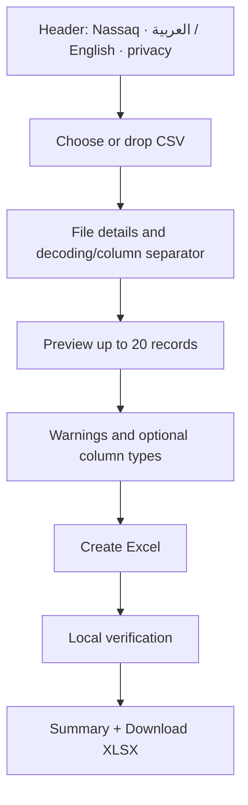

# Nassaq — UI/UX Specification

**Version:** 1.0 · **Product language:** Arabic-first with full English support · **Layout:** RTL/LTR-aware, one-page guided workflow.

## 1. Design goals

The user should not have to understand “encoding”, “delimiter”, “type coercion”, or “formula injection” to use Nassaq. Present a short step-by-step interface and natural labels: “How does the Arabic text look?”, “How are columns separated?”, “Keep as text (recommended)” and “Create Excel”. Advanced technical terms belong in help popovers, not primary instructions.

**Visual tone (owner-approved shell restyle, 2026-10-29):** confident, geometric
Neo-Brutalism using yellow `#ffe17c`, charcoal `#171e19`, sage `#b7c6c2`, white
and black. Use 2px black borders, 4px/8px zero-blur offset shadows, and locally
bundled OFL typography with Arabic glyph coverage. Preserve a compact,
utility-first page and accessible contrast; color is never the sole channel.
See `../DESIGN.md` for the implemented tokens and interaction rules.

## 2. App anatomy and sequence

**Header:** Nassaq wordmark (`نسّق` Arabic), language toggle, “How it works” lightweight in-page explanation, GitHub link only after repository exists. No sign-in button.

**Step A — choose file:** Large labeled button and drag/drop target, clear max 2 MiB and CSV/TXT support; file name and raw size displayed after selection; drag/drop keyboard equivalent. Privacy microcopy: “Your file is processed in this browser. It is not uploaded.”

**Step B — understand file:**
- “Text encoding” field with recommended choice and help. When BOM exists, small “Detected from file” copy; when not, “Suggested — check the sample”. Options UTF-8, Windows Arabic (Windows-1256), Arabic ISO (ISO-8859-6). Decoding failures clearly identify an action.
- “Columns separated by” select (Comma, Semicolon, Tab, Pipe) and “Not sure? Compare the preview.” Ambiguous cases require choice/confirmation before export.
- Toggle “First row contains column names” default **on**. This affects label/cap only; it does not delete or transform first row.

**Step C — preview:** Horizontally scrollable table with column letters and exact user content (first 20 records maximum), row numbers, safe escaped text, visible indication when text includes line breaks or surrounding spaces. Clip visually **without** clipping stored data; keyboard accessible scroll. Show “Showing first 20 of N records” when needed. For very long cells, expandable/copy-only affordance only if safe; no `dangerouslySetInnerHTML`.

**Step D — review:** One summary strip, e.g. “3 values worth checking — all will remain text unless you change a column.” Group risk counts by category. Link focus to relevant table cell; tooltip explains danger without revealing entire private value in notifications/logs. Per-column dropdowns default **Keep as text (recommended)**; optional **Convert to number** triggers all-row validation and clear disclaimer. No Date type in MVP. A conversion that would lose zeros is blocked and shows first offending **row positions**. For an all-text safe export, warnings remain informational and need no checkboxes per cell.

**Step E — create and download:** Primary `Create safe Excel`; inline phase statuses “Reading”, “Checking data”, “Building Excel”, “Verifying cells”. Never use fake percentage values. On success show `Verified: N rows, M columns`, text/number totals, and `Download XLSX` button. On error, disable download; allow settings correction or new file.

## 3. Components and responsibilities

| Component | Responsibility / accessibility |
|---|---|
| `AppShell` | Language, description, content landmarks |
| `FileDropzone` | Native file input, drag/drop, size/type hint, keyboard support |
| `ImportDetails` | File name/size, reset/change file |
| `EncodingSelector` | Encoding choice and certainty explanation |
| `DelimiterSelector` | Candidate choice and width preview |
| `HeaderModeToggle` | First row handling without modifying data |
| `DataPreviewTable` | Up to 20 parsed rows, row/column headers, safe text, horizontal scroll |
| `RiskSummary` | Count + detail list with severity and explanatory language |
| `ColumnTypeSelector` | Text/Number, accessible names, full-column gate output |
| `ProcessStatus` | Pending/current/completed stage, aria-live polite |
| `ValidationResult` | Exact summary, verification status, blocking reason |
| `DownloadAction` | Enabled only after verified worker response |
| `ErrorBanner` | Error code translated to actionable copy; focus target |

Suggested minimal shadcn primitives: Button, Card, Select, Alert, Switch/Checkbox, Table/ScrollArea if required, Tooltip. Keep native forms when simpler. Avoid heavyweight data grid or virtualizer for a 20-row sample.

## 4. Screen and state behavior

| State | User sees | Primary action |
|---|---|---|
| `idle` | Explainer, drop zone, local privacy text | Choose CSV |
| `reading` | File card + spinner, cancel | Cancel |
| `review` | Settings, preview, risk counts, types | Create Excel |
| `generating` | Phase status, buttons disabled except cancel | Cancel |
| `verifying` | Validation in progress; download absent | Cancel |
| `ready` | Verification counts + download | Download XLSX / New file |
| `error` | Plain-language problem, location if safe, repair guidance | Change selection or choose new file |
| `cancelled` | Fresh empty flow; no stale results | Choose CSV |

On encoding/delimiter/header/type change: invalidate previous XLSX immediately; re-analysis is required for encoding/delimiter, reclassification needed for header/type. Never let old `READY` bytes survive new settings. A late job completion after cancellation must be ignored.

## 5. Arabic/English copy deck (MVP)

| Key | Arabic | English |
|---|---|---|
| title | نسّق ملفاتك بأمان | Import your CSV safely |
| choose | اختر ملف CSV | Choose a CSV file |
| drag | أو اسحبه إلى هنا | Or drag it here |
| privacy | ملفك يُعالَج على جهازك ولا يُرفع إلى خادم. | Your file is processed on this device and is not uploaded. |
| encoding | طريقة قراءة النص | Text encoding |
| delimiter | الفاصل بين الأعمدة | Column separator |
| header | الصف الأول يحتوي على أسماء الأعمدة | First row contains column names |
| text | احتفظ بالنص كما هو (موصى به) | Keep as text (recommended) |
| number | حوّل إلى رقم (بموافقتك) | Convert to number (your choice) |
| risk | قيم تحتاج مراجعة | Values worth reviewing |
| preview | معاينة البيانات | Data preview |
| create | أنشئ ملف Excel آمنًا | Create safe Excel |
| verify | جارٍ التأكد من حفظ جميع القيم | Verifying that values were preserved |
| download | تنزيل ملف XLSX | Download XLSX |
| new | اختر ملفًا آخر | Choose another file |
| badEncode | تعذّر قراءة النص. جرّب طريقة قراءة أخرى. | We couldn't read this text. Try another encoding. |
| noData | لا توجد صفوف بيانات قابلة للتحويل. | There are no data rows to convert. |
| tooLarge | الملف أكبر من الحد المسموح (2 ميجابايت). | File exceeds the 2 MiB limit. |
| verifyFail | لم نتمكن من التأكد من سلامة الملف. لم يبدأ التنزيل. | We couldn't verify this workbook, so no download was created. |

Actual strings should be kept in `ar` and `en` resource files; translators must review grammar, formatting and terminology before release. Use both Arabic and Latin numbers as data **without automatic content conversion**. UI counters may be locale-formatted without touching source cells.

## 6. RTL/LTR behavior

- Set top-level `html` `lang="ar" dir="rtl"` or `lang="en" dir="ltr"` when locale changes; keep locale choice in **memory** for MVP (no persistence). Arabic default.
- Use CSS logical properties (`margin-inline-start`, `text-align:start`) and Tailwind logical utilities where available, not a scattering of `left/right` hacks.
- Render **cell data inside** `<bdi dir="auto">` or an equivalent direction-isolating text wrapper so mixed Arabic/English, phone strings and punctuation are readable and do not reorder surrounding UI. This changes display direction only, not the source characters.
- Labels and controls mirror logically, but data order (column A to column B) remains stable. User can horizontally scroll even in RTL. Column indexes remain 1-based and fixed.
- Keyboard direction/number input tests required in both locales; icon arrows may mirror where semantically directional.

## 7. Accessibility and responsive rules

- WCAG 2.2 AA aspirational baseline; validate essential flow with keyboard only and screen reader (NVDA/VoiceOver smoke).
- Use real `<label>` or `aria-labelledby`, not placeholder-only labels. File drop zone has standard input alternative. Visible focus, Enter/Space activation.
- Use `aria-live="polite"` for asynchronous phase completion and summary. For blocking errors, focus error heading and associate with affected selector; never trap focus in nonmodal alerts.
- Preview uses semantic `<table>`, `<thead>`, `<th scope="col">`, row headings and caption. Scroll area clearly focusable. No spreadsheet keyboard editor requirement.
- Error/warning icons accompanied by text. Long names truncate visually with full tooltip; do not lose full name from accessibility tree.
- Desktop ≥1024px: two-column settings and preview only if useful. Tablet/small viewport: stack everything, scroll preview, full-width main CTA. Phone devices may hit memory constraints; explain size cap and avoid making desktop assumptions in markup.
- Respect `prefers-reduced-motion`, avoid animation dependent on language or state.

**Shell interaction decision (2026-10-29):** File selection focuses the selected-file
heading; reset restores focus to the native file input without scrolling. The
picker and selected-file card share an 18rem minimum height to reduce layout jumps
(expanded content may grow naturally). Controls share 2px borders, corners no
larger than 12px, and immediate focus feedback. The owner-approved Neo-Brutalist
restyle adds a 160ms strong ease-out 4px push interaction for fine-pointer hover;
shadow changes are instantaneous, never interpolated. Keyboard focus and reduced
motion suppress spatial movement; reduced motion also removes transitions. Coarse
pointer buttons have at least 44px targets, and the picker CTA fills the phone
layout. A native keyboard/touch-accessible disclosure exposes the complete,
escaped, direction-isolated filename without relying on a hover tooltip.

## 8. Edge states and micro-interactions

| Situation | Behavior |
|---|---|
| File name with HTML-like characters | Render escaped text; safe sanitized download basename |
| File chosen twice | Selecting same file after reset works (clear input value) |
| User toggles Number on unsafe column | Block conversion, show earliest failing 5 row indexes and “Keep as text” shortcut |
| Delimiter ambiguous | Show options, require explicit review, reparse on change |
| Wrong encoding but technically decodable | Show sample and warning; no automatic “correction” |
| Output verification fails | Error with no XLSX download; suggested GitHub issue without attaching sensitive CSV |
| Huge sample cell | Render safely in constrained scroll; full value remains untouched in worker |
| Offline after first visit | Conversion should run if required assets are cached by browser; **do not promise offline-first installability** without service-worker implementation |

## 9. Design acceptance checklist

Both locale flows work; no overflow breaking CTA; tab navigation completes upload→review→download; mixed-script cells isolate correctly; warning does not suggest actual mutation in Text mode; failure cannot expose download; reset clears sample, statuses and object URLs; copy matches actual client-only behavior.
