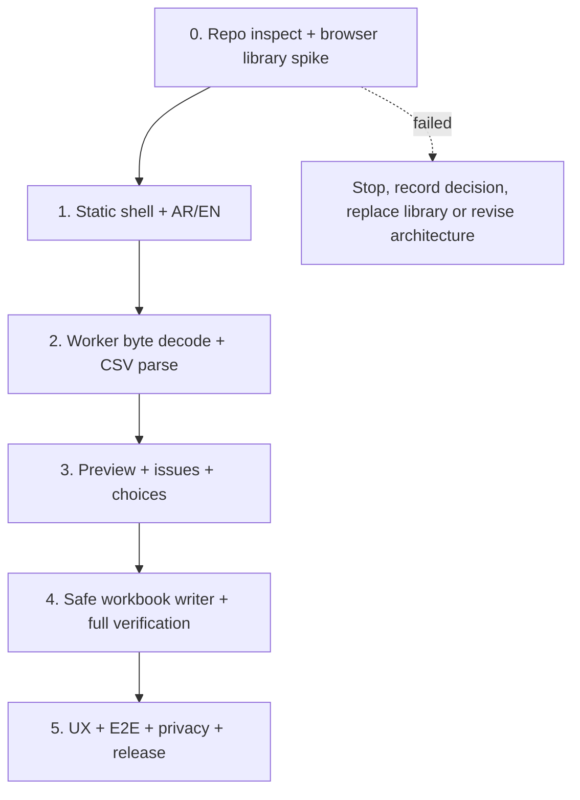

# Nassaq — Phase-by-Phase Implementation Plan

**Version:** 1.0 · **Goal:** smallest trustworthy CSV→XLSX MVP. Phase 0's isolated technical spike is complete; no product UI or later-phase implementation has been started.

## 1. Starting point and constraints

This documentation package was authored from the supplied product brief. **The existing application repository was not provided or inspected.** Before implementation, inspect the actual repository and preserve code/configuration/docs if already present; do not assume it is blank. If conflicts with the architecture are found, record an ADR and update specifications before changing code.

**Hard guardrails:** static-only; zero auth/backend/database; zero remote file transfer; free and open source; English/Arabic UI; text-first; no automatic data cleaning; downloadable XLSX only after round-trip validation; caps: 2 MiB, 10k data rows, 50 columns, 100k data cells, 32,767 UTF-16 units/cell.

**Time:** target **~8–12 focused engineering hours**, assuming a familiar React/TypeScript environment, no existing conflicts, and a successful library spike. This is an **ambitious planning budget, not a delivery promise**. Safari/Firefox fixes, unresolved dependency vulnerabilities, empty-cell serialization quirks and deep QA can realistically take additional time; preserve safety and tests, not the estimate.

## 2. Gates and dependencies

Each phase owns a coherent working milestone. Do **not** add features from later phases “because it is easy.” If phase 0 is blocked, re-evaluate ExcelJS and/or worker packaging before implementing the UI.

## Phase 0 — Repository inspection and feasibility spike (1.0–1.5 h)

**Objective:** eliminate high-risk unknowns before feature development.

**Execution evidence:** see the [XLSX worker feasibility report](XLSX_WORKER_FEASIBILITY.md). Phase 0 **passed**:
strict typecheck, 5 Node integration tests, static production build and 15 browser
checks across Chromium/Firefox/WebKit, including downloaded-XLSX comparison.
The audit has 2 reviewed moderate findings and no high/critical findings. ExcelJS
remains selected; Phase 1 is technically ready but requires separate authorization.

**Tasks:**
1. Inspect git status, lockfile, project structure, existing implementation, scripts, docs and tests. Preserve it.
2. Confirm Node/tool versions supported by current Vite/React and selected packages; choose/pin stable compatible releases.
3. Confirm library license, build and lockfile audit. Investigate transitive vulnerabilities and decide whether reachable/high severity.
4. In a **temporary isolated experiment** (may be outside repository), prove Vite worker can import ExcelJS, write a buffer, **re-open** it, preserve `"0004"`, `"=1+1"`, `""` text and Arabic, and transfer an XLSX ArrayBuffer back to main UI on Chrome/Firefox/WebKit. Verify empty-string semantics precisely.
5. Review realistic bundle size and benchmark small vs max synthetic sample. Confirm worker availability and output's opened-file representation.
6. If library cannot meet integrity, stop and replace writer/reader with a researched alternative; update `02`, `04`, `07`, `09` and `AGENTS.md` consistently before further work.

**Expected files:** no persistent source required for planning; implementation phase might add test spike under `tests/` if useful, plus lockfile and ADR updates.

**DoD:** a documented pass/fail for license, worker runtime and exact text/empty/formula tests. **Tests:** browser-generated XLSX parsed back and inspected (not just an import succeeds). **Dependency:** none.

## Phase 1 — Static shell, tooling, localization (1.0–1.5 h)

**Objective:** minimal AR/EN accessible shell with no backend.

**Execution evidence (2026-10-28, branch `feat/phase-1-shell`):** Phase 1
**passed**: strict `npm run typecheck`, production `vite build` (static
`dist/`), and 21 Playwright checks (7 cases × Chromium/Firefox/WebKit) covering
Arabic-default RTL, EN toggle with LTR/`lang`/`title` sync, keyboard-reachable
labelled file input, synthetic drag/drop file details with `bdi` isolation,
same-file reselection after reset, and zero non-app network requests. Stack:
Vite 8.3.5, React 19.3.1, TypeScript 7.0.2 (TS7 removed `baseUrl`; alias via
`paths` only), Tailwind 4.3.3, i18next 26.5.11 + react-i18next 17.1.9,
lucide-react 1.62.0 (brand icons removed upstream; the header GitHub mark is
an authored inline SVG). shadcn registry `Button` generated via
`shadcn@4.23.0 add`, adding `cn@0.5.0` (MIT), `radix-ui@1.8.1` (MIT) and
`class-variance-authority@0.7.1` (Apache-2.0); `npm audit`: 0 vulnerabilities.
File size/type enforcement is intentionally deferred to Phase 2 gating; the
dropzone only displays the caps. Owner visual review of the rendered AR/EN
shell is still recommended.

**Shell review follow-up (2026-10-29, `fix/shell-interaction-polish`):**
Implemented focus continuity, shared color-only control feedback, immediate
focus/pressed states, reduced-motion handling, coarse-pointer targets, a
full-width mobile picker CTA, matched minimum file-region heights, and native
full-filename disclosure. `npm run typecheck` and `npm run test:e2e` passed,
including the production build and 30 Playwright checks (10 cases across
Chromium/Firefox/WebKit). New regressions cover AR/EN focus/reset, 320px touch
layout and long filenames, and reduced motion. An initial Firefox focus-modality
difference was corrected before the passing run. The design detector reported
no findings. Real-device and screen-reader smoke remain manual follow-ups.
This is a Phase 1 shell refinement; Phase 2 remains separately authorized.

**Owner-approved visual restyle (2026-10-29, `style/neo-brutalist-shell`):**
The owner selected restyling the existing compact shell, preserving its section
order, bilingual content, and file-selection interactions. The shell now uses
yellow/charcoal/sage fields, 2px black borders, zero-blur hard shadows, a fixed
80px header, an SVG dot tile, and fine-pointer-only push-button feedback. Reduced
motion and keyboard focus suppress translation. The owner approved locally
hosted OFL alternatives (Archivo, Manrope, Noto Sans Arabic) after the downloaded
Fontshare licenses were found to restrict repository redistribution; source URLs
and license notices are included in `public/fonts/`. No package changes.
`npm run typecheck`, production build, and all 33 Playwright checks passed across
Chromium/Firefox/WebKit. The new motion regression checks pointer hover,
keyboard-visible focus, and reduced-motion behavior; the first run caught and
resolved an inherited outline utility overriding the authored focus style.
Chromium layout checks at 320/375/768/1280px passed in AR/EN with all local fonts
loaded, 2px panel borders, 8px zero-blur panel shadows, and no horizontal
overflow. Desktop/mobile screenshots and expanded synthetic filename disclosure
were inspected; the design detector reported no findings. See `../DESIGN.md`.
Physical-device and screen-reader smoke remain manual release follow-ups.

**Tasks:** Vite React TS strict; Tailwind v4; limited shadcn/ui primitives; react-i18next Arabic default; `dir`/`lang` switch; accessible `FileDropzone`, AppShell; build scripts; static-only deployment config. Avoid router unless needed for a legal/privacy page (simple in-page section is enough).

**Expected modules:** `src/main.tsx`, `src/app/App.tsx`, `src/app/providers.tsx`, `src/i18n/*`, `src/components/import/FileDropzone.tsx`, `src/styles/*`, `vite.config.ts`, `package.json`, configs.

**Acceptance:** project builds to `dist`, no API calls, language/RTL works, choose file accessible via keyboard. **Tests:** typecheck/build + one locale/drag/drop smoke. **Depends:** phase 0.

## Phase 2 — Client worker, encoding, CSV parsing (2.0–2.5 h)

**Objective:** immutable byte→reviewable parsed table, no silent coercion.

**Execution evidence (2026-10-29, branch eat/phase-2-worker):** Phase 2
**passed**: strict pm run typecheck, 66 Vitest unit tests across 4 test suites
(encoding.test.ts, delimiter.test.ts, csv.test.ts, limits.test.ts), production
ite build (static dist/ with isolated import.worker chunk), and 72 Playwright
checks (24 test cases × Chromium/Firefox/WebKit). Delivered modules:
src/domain/limits.ts (caps: 2 MiB, 10k data rows, 50 columns, 100k cells, 32,767
UTF-16 units/cell), src/domain/protocol.ts (typed worker RPC messages with jobId),
src/domain/encoding.ts (strict UTF-8 BOM/non-BOM, legacy Windows-1256/ISO-8859-6,
binary detection), src/domain/delimiter.ts (deterministic scoring over comma/semicolon/tab/pipe
with multi-column weighting), src/domain/csv.ts (strict Papa Parse string arrays,
phantom newline removal, uneven-row detection, structural validation),
src/worker/import.worker.ts (dedicated Web Worker pipeline), and src/lib/worker-client.ts\r
(lifecycle, cancellation, zero-copy ArrayBuffer transfer). All data-integrity invariants
from docs/04_DATA_INTEGRITY_AND_VALIDATION.md and docs/03_CSV_PARSING_AND_ENCODING.md\r
are respected. Zero vulnerabilities in npm audit (vitest upgraded to 5.0.5).

**Tasks:** typed worker request/response messages, transfer input bytes, strict UTF-8/BOM, manually selectable Windows-1256/ISO-8859-6, delimiter candidates, Papa quote-aware parser as string arrays, limits and errors, safe final-newline semantics, 20-row preview and full-file metadata. Return only summary+sample to UI; data stays in worker. Disallow stale jobs; cancel/reset via terminate/recreate.

**Expected modules:** `src/worker/import.worker.ts`, `src/domain/encoding.ts`, `src/domain/delimiter.ts`, `src/domain/csv.ts`, `src/domain/limits.ts`, `src/domain/protocol.ts`, `src/lib/worker-client.ts`.

**Acceptance:** Arabic UTF-8 and selected legacy fixtures, comma/semicolon/tab/pipe, quoted multiline cells, uneven rows and limits behave as `03`. **Tests:** encoding bytes + malformed CSV/quoted values + limits unit/integration. **Depends:** phase 1.

## Phase 3 — Risk review UI and safe type policy (1.5–2.0 h)

**Objective:** user can see ambiguous import choices and inspect risks before export.

**Execution evidence (2026-10-29, branch `feat/phase-3-review`):** Phase 3
**passed**: strict `npm run typecheck`, 95 Vitest unit tests across 6 test suites
(`risks.test.ts`, `numeric-policy.test.ts`, `encoding.test.ts`, `delimiter.test.ts`,
`limits.test.ts`, `csv.test.ts`), production `vite build` (static `dist/` with
isolated `import.worker` chunk), and 99 Playwright E2E checks (33 test cases ×
Chromium/Firefox/WebKit) across `shell.spec.ts`, `phase2.spec.ts`, and `phase3.spec.ts`.
Delivered modules:
`src/domain/risks.ts` (cell & full-table risk scanner for LEADING_ZERO, LONG_NUMBER,
DATE_SHAPED, SCIENTIFIC_NOTATION, DECIMAL_SEPARATOR_AMBIGUITY, FORMULA_LIKE,
MIXED_DIRECTION), `src/domain/numeric-policy.ts` (strict full-column numeric gate
enforcing ASCII canonical grammar, safe integers, 15 significant digits cap, identifier
risk protection, lexical roundtrip preservation `String(Number(token)) === token`,
and reporting up to 5 failing row coordinates without disclosing cell content),
`src/domain/protocol.ts` and `src/domain/csv.ts` (worker off-thread risk and numeric
column analysis), `src/components/import/EncodingSelector.tsx` (UTF-8 BOM detection vs
suggestion, Windows-1256, ISO-8859-6), `src/components/import/DelimiterSelector.tsx`
(interactive separator buttons re-parsing from raw bytes),
`src/components/import/HeaderModeToggle.tsx` (accessible header toggle),
`src/components/import/ColumnTypeSelector.tsx` (per-column Text/Number selector with
blocking alert on ineligible columns), `src/components/import/RiskSummary.tsx` (summary
strip with category breakdowns), `src/components/import/DataPreviewTable.tsx` (semantic
accessible table with `<bdi dir="auto">`, column letter headers, row indices, empty/newline/space
indicators, and cell risk flags), `src/app/import-state.ts` (review state management),
and `src/components/import/ImportDetails.tsx` (coordinated review workflow). All
data-integrity invariants from `docs/04_DATA_INTEGRITY_AND_VALIDATION.md` and UI
requirements from `docs/05_UI_UX_SPECIFICATION.md` and `DESIGN.md` are satisfied.

**Tasks:** file details, encoding/delimiter selectors, header toggle, preview table, risk flags for zeros/IDs/dates/formulas, Text default per column, opt-in Number with full-column strict gate, loading/error states, invalidation on option change. User can change encoding and delimiter from the **raw bytes**.

**Expected modules:** `src/domain/risks.ts`, `src/domain/numeric-policy.ts`, `src/components/import/{EncodingSelector,DelimiterSelector,DataPreviewTable,RiskSummary,ColumnTypeSelector}.tsx`, `src/app/import-state.ts`.

**Acceptance:** sample readable in AR/EN, no HTML injection, wrong choices cannot export without user review, Number rejected for `002`, `0.10`, long IDs. **Tests:** risk table/unit + review E2E + keyboard selector. **Depends:** phase 2.

## Phase 4 — Safe XLSX and mandatory verification (2.0–2.5 h)

**Objective:** export only an exact **verified** workbook.

**Execution evidence (2026-10-29, branch `feat/phase-4-export`):** Phase 4
**passed**: strict `npm run typecheck`, 112 Vitest unit tests across 9 test suites
(`verify.test.ts`, `xlsx-adapter.test.ts`, `download.test.ts`, `risks.test.ts`,
`numeric-policy.test.ts`, `encoding.test.ts`, `limits.test.ts`, `delimiter.test.ts`,
`csv.test.ts`), production `vite build` (static `dist/` with isolated `import.worker` chunk),
and 108 Playwright E2E checks (36 test cases × Chromium/Firefox/WebKit) across
`shell.spec.ts`, `phase2.spec.ts`, `phase3.spec.ts`, and `phase4.spec.ts`.
Delivered modules:
`src/domain/export-manifest.ts` (manifest and failure data contracts),
`src/domain/verify.ts` (pure domain verification algorithm checking single 'Data' sheet, exact grid bounds, strict cell types and values, total formula/hyperlink absence, and no unexpected out-of-bounds cells without disclosing private cell content),
`src/worker/xlsx-adapter.ts` (ExcelJS generation and read-back loader returning verified ArrayBuffer on 100% pass),
`src/lib/download.ts` (sanitized export filename, Blob URL lifecycle, safe local download trigger),
`src/components/import/ValidationResult.tsx` (accessible AR/EN verification result banner with aggregate cell counts and coordinates on failure),
`src/components/import/DownloadAction.tsx` (primary action button, progress spinner, verified download trigger),
`src/domain/protocol.ts` and `src/worker/import.worker.ts` (worker export RPC and active parsed table retention),
and `src/components/import/ImportDetails.tsx` (integrated review, verification, and download lifecycle). All data-integrity invariants from `docs/04_DATA_INTEGRITY_AND_VALIDATION.md` and UI requirements from `docs/05_UI_UX_SPECIFICATION.md` and `DESIGN.md` are satisfied.

**Tasks:** writer adapter in worker, one `Data` worksheet, text literal assignments, verified approved Number conversions, no formula/hyperlink objects, preserve empty fields, generate ArrayBuffer, re-open with ExcelJS, verify each row/column/text/number type/value, dimensions and formula absence, return bytes only on full pass, sanitized local download, cleanup old object URLs.

**Expected modules:** `src/domain/export-manifest.ts`, `src/worker/xlsx-adapter.ts`, `src/domain/verify.ts`, `src/lib/download.ts`, `src/components/import/ValidationResult.tsx`, `src/components/import/DownloadAction.tsx`.

**Acceptance:** `00073`, `12345678901234567890`, `03-04`, Arabic and `=1+1` preserved exactly; no formula cells; failed/tampered verification blocks download. **Tests:** workbook read-back fixtures and mismatch injection, end-to-end download inspection. **Depends:** phase 3 and passed phase 0.

## Phase 5 — Security, final QA, release preparation (1.5–2.0 h)

**Objective:** credible public MVP with reproducible tests.

**Execution evidence (2026-10-29, branch `feat/phase-5-release`):** Phase 5
**passed**: strict `npm run typecheck`, 143 Vitest unit tests across 11 test suites
(`golden-fixtures.test.ts`, `openxml-structure.test.ts`, `verify.test.ts`,
`xlsx-adapter.test.ts`, `download.test.ts`, `risks.test.ts`, `numeric-policy.test.ts`,
`encoding.test.ts`, `limits.test.ts`, `delimiter.test.ts`, `csv.test.ts`),
production `vite build` (static `dist/` with `import.worker` chunk and `_headers`),
and complete Playwright E2E coverage across Chromium, Firefox, and WebKit
(`shell.spec.ts`, `phase2.spec.ts`, `phase3.spec.ts`, `phase4.spec.ts`, `phase5-release.spec.ts`).
Delivered release assets:
- `public/_headers` & `index.html`: Content Security Policy and defense-in-depth static headers.
- `src/lib/download.ts`: Enhanced filename sanitizer stripping bidi overrides, control characters, path traversal, and enforcing 100-char length caps.
- `src/components/import/PrivacyModal.tsx`: Accessible bilingual dialog articulating 100% local processing, zero telemetry/cookies, session memory boundaries, static hosting request logging, and vulnerability reporting.
- `tests/fixtures/*`: 28 golden synthetic CSV fixtures verifying the entire acceptance matrix.
- `tests/unit/openxml-structure.test.ts`: Independent zip/XML inspection verifying zero `<f>` tags, no `<hyperlinks>`, and valid OpenXML spreadsheet types.
- `tests/e2e/phase5-release.spec.ts`: Sentinel network interception tests, 100% offline verification, storage leak audit, hostile filename tests, and reset recovery.
- `README.md`, `LICENSE` (MIT, Ashraf Murad), `SECURITY.md`, `CONTRIBUTING.md`, `.github/workflows/ci.yml`.
- `package.json`: Version bumped to `0.1.0` (MVP candidate).
All P0 requirements and release criteria are satisfied.

**Tasks:** add negative fixtures, privacy/network interception, CSP draft with static host headers, output filename sanitation, worker cancellation/error recovery, README/license/security/privacy pages, cross-browser smoke, usability copy, production build, first public version tag. Independent XML/Excel/LibreOffice opening tests on critical fixtures. Confirm bundle and memory caps.

**Expected files:** `tests/e2e/*`, `tests/fixtures/*`, `README.md`, `LICENSE`, `SECURITY.md`, privacy content, CI workflow, host headers config, docs updates.

**Acceptance:** all P0 requirements and release checklist green. **Tests:** Vitest, Playwright, build, audit, manual Safari/Firefox/open-in-Excel. **Depends:** phase 4.

## 3. Estimate summary and sequencing

| Phase | Estimate (hours) | Milestone |
|---|---:|---|
| 0 — Feasibility / repository | 1.0–1.5 | Workbook + worker proof |
| 1 — Shell / localization | 1.0–1.5 | Static bilingual page |
| 2 — Parse / encoding | 2.0–2.5 | Preview with safe parsing |
| 3 — Review / type policies | 1.5–2.0 | User-approved settings |
| 4 — Export / verify | 2.0–2.5 | Safe XLSX ready |
| 5 — QA / release | 1.5–2.0 | Publish-ready MVP |
| **Total** | **9.0–12.5** | Aspirational focused-engineering window |

**Schedule rule:** 12.5 is near the 8–12 hour target, not a guarantee; a more conservative allocation for comprehensive release QA is 15–24+ hours. Do not skip security/verification to fit the target. Parallelize only documentation/UI copy independently; share one integration baseline. Recommended AI coding sessions: **one phase per session** after reading `AGENTS.md` and all referenced docs, with a review gate between phases.

## 4. Acceptance fixture and gate matrix

| Gate | Must demonstrate |
|---|---|
| P0 | Exact literal `""`, `"0004"`, `"=1+1"` and Arabic after write/re-open in worker |
| P1 | Static `dist`, AR/EN, RTL/LTR and accessible file input |
| P2 | Strict encoding, quoted/multiline fields, deterministic delimiter decisions, row widths/limits |
| P3 | User reviews risks, default Text, Number rejects unsafe values, preview safe |
| P4 | Full cell-by-cell XLSX comparison and block on mismatch |
| P5 | E2E downloaded output + real app smoke + privacy/no outgoing file data |

Any failed critical gate stops moving to next phase. A “working download” that cannot be verified does **not** meet MVP.

## 5. Feature prioritization

**MVP P0:** CSV→XLSX, encoding selection and honest detection, delimiter selection, quote/multiline parsing, limited sample preview, risk counts, Text/Number column types, full workbook round-trip verification, local download, 2 locales, file/structural limits, offline processing *after code/assets load*.

**P1 improvements:** clearer contextual explanations, enhanced download summary, keyboard focus polish, broader browser monitoring, simple static help/privacy page.

**Post-MVP only:** advanced workbook type maps, multiple input files, XLSX imports, saved presets, decimal/date conversions, manual cell editing, bigger files/streamed XLSX writer, more encodings, additional delimiters, source repair, third-party system integrations, AI.

## 6. AI-agent execution pattern

For each phase, start a clean coding-agent session with: (1) exact phase, (2) `AGENTS.md`, (3) relevant docs, (4) inspected repo state, (5) explicit acceptance cases. Agent should inspect before editing, implement **only** phase scope, run tests, report modified files and unresolved findings, update docs if decisions changed, and stop. Never launch full autonomous feature implementation based on all 10 docs at once without review checkpoints.

## 7. Final review questions (implementation-time, not product ambiguity)

- Did ExcelJS runtime and dependencies pass phase-0 browser/security checks? If not, what documented replacement was approved?
- Did exact empty-string text survive writer/read-back? If not, pause instead of relaxing invariant.
- Can the max accepted fixture finish reliably in Chrome/Firefox/Safari without freezing UI? If not, lower caps and retest.
- Are privacy/copy claims true on the deployed host (headers, fonts and outgoing traffic)?
- Does opening XLSX with Excel/LibreOffice show literal formula-like strings and long IDs?

**Definition of Done:** Tests/checklists attached to each phase are satisfied; no unapproved scope growth; docs agree; no unresolved blocking integrity/security risk.
